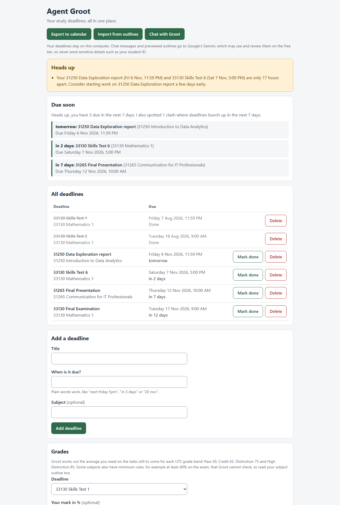

# Agent Groot: a study deadline assistant

[](https://github.com/Richardyan701/deadline_tracker_agent/actions/workflows/tests.yml)

**Agent Groot is a free, open-source study assistant that keeps track of your university deadlines.** Drop in your subject outlines and it finds every assessment and its real date, then reminds you before anything is due. You can also just tell it: *"Quiz 2 due next friday 5pm"*.

Built by Richard, a first-year Artificial Intelligence student at UTS in Sydney, with Google's Agent Development Kit (ADK) and Gemini 3.5 Flash. It runs on your own computer.



*The home page, shown with made-up example deadlines.*

> **Privacy:** your deadlines stay on your computer, but every chat message and every outline you preview is sent to Google's Gemini. On the free tier, Google may use and review it. Never enter anything sensitive, such as your student ID, passwords, health or money details.

## What it does

- **Reads your subject outlines** (PDF, Word, slides, spreadsheets, images and more) and turns "due in week 7" into a real date using the official UTS calendar.
- **Understands plain English dates** like "next friday 5pm", "in 3 days" or "20/11". The date maths is done by tested Python code, not guessed by the AI.
- **Reminds you** of anything overdue or due soon, and **warns you about clashes** when deadlines bunch up.
- **Works out the mark you need** on the rest of a subject to get a Pass, Credit, Distinction or High Distinction.
- **Exports to your calendar** (.ics) and imports your timetable and Canvas calendar.
- **Has a home page that uses no AI**, plus a chat with Groot.

## Quick start

You need **Python 3.11 or newer** and a free **Gemini API key** from [Google AI Studio](https://ai.google.dev/gemini-api/docs/api-key).

1. **Set up once.**
   - Windows: double-click `setup_windows.bat`.
   - Linux or macOS: run `./setup.sh`.

   It installs everything and asks for your key.
2. **Start Groot.**
   - Windows: double-click `start_groot.bat`.
   - Linux or macOS: run `./start_groot.sh`.

   Your browser opens the home page at <http://127.0.0.1:8000/groot>. Press Ctrl+C in the start window to stop.
3. **Use it.** Add deadlines on the home page, import your outlines, or open the chat and say hello.

If something goes wrong, run the setup checker. It tells you what to fix:

```
.\.venv\Scripts\python.exe -m deadline_agent.check_setup     (Windows)
.venv/bin/python -m deadline_agent.check_setup               (Linux and macOS)
```

## A quick example

> **You:** Add Quiz 2 due next friday 5pm for Machine Learning
>
> **Groot:** Added **Quiz 2** for **Machine Learning**, due Friday, 13 November 2026 at 5:00 PM!
>
> **You:** what's my next deadline?
>
> **Groot:** Your next deadline is **Quiz 2** for **Machine Learning**, due on Friday, 13 November 2026 at 5:00 PM.

This is real output from the real Gemini model. Groot passes "next friday 5pm" to its tool exactly as typed, and Python works out the date.

## How well does it work?

Measured with the real Gemini model, not just claimed:

| Test | Result |
| --- | --- |
| **Reading 5 real UTS outlines** | 93% of assessments found, none invented, **0 silently wrong dates** |
| **63 realistic student messages** (dates, listing, marking done, off-topic, prompt-injection attempts) | **63 of 63 passed** |
| **Automated tests** | About 1,500, run on Python 3.11, 3.13 and 3.14 on every change |

Gemini does not answer the same way every time, and these are small samples, so read them as "no failures in these runs", not "it never fails". The weak spot was one outline (31265), where Groot missed two items and got two weights wrong. Full tables are in the [reference](docs/reference.md#results-so-far).

## Why does Groot feel similar to Notion?

Because both give you one place to keep your study life in order: a list of tasks with due dates, grouped by subject, with reminders and an AI helper you can talk to. If you have used a Notion assignment tracker, Groot's home page will feel familiar.

**What is similar**

- A list of deadlines with a due date, a subject and a done tick.
- Reminders for what is overdue or due soon.
- An AI assistant that adds and finds things when you ask in plain English.
- Your deadlines can go into a calendar.

**What is different**

| | Groot | Notion |
| --- | --- | --- |
| What it is for | One job: university deadlines | A general workspace for notes, documents and databases |
| Where your data lives | A file on your own computer | Notion's cloud, in your account |
| Setting up a tracker | Nothing to build | You build one or pick a template |
| Phones and sharing | No. One computer, one user | Yes. Syncs across devices and works for teams |
| Notes, documents and wikis | No | Yes |
| Cost | Free and open source, with Gemini's free tier | Free plan, with paid plans for more AI use |

**What Groot does that Notion does not do out of the box**

- **Knows the UTS calendar.** "Due in week 7" becomes the real date, with the mid-session break and public holidays handled. In Notion, you or the AI have to work that date out.
- **Works dates out in tested code, not by AI.** The same phrase always gives the same date, and unclear dates are refused instead of guessed.
- **Shows how sure it is.** Every imported row is marked exact, assumed or needing your date, and nothing is saved until you tick it.
- **Warns about clashes and works out the mark you need** with no formulas to write.
- **Publishes its accuracy.** The results above come from real outlines and real chats, including the mistakes.
- **Runs without an account**, and the home page works with no AI at all.

**Where Notion is better:** it works on your phone, syncs everywhere, lets you edit anything, handles notes and group work, and has a polished design. Groot is not trying to replace it. This comparison is based on Notion's public help pages in November 2026, and Notion changes quickly.

## Things to know

- **The Gemini free tier is small:** about 5 requests a minute and 20 a day, which is roughly 8 to 10 chat messages that use a tool. Groot says so politely when you hit a limit. The home page never uses Gemini.
- **Check the review table before saving imported deadlines.** Gemini can misread an outline.
- **UTS only, and only 2026.** The calendar covers Autumn and Spring 2026.
- **One user, one local file.** There are no accounts, and nothing syncs between devices.
- **Run it on your own computer only.** The chat page has no login.
- **The grade calculator can't check minimum rules** (like a minimum exam mark). Read your subject outline.

## Learn more

The [full reference](docs/reference.md) covers:

- [Date phrases it understands](docs/reference.md#date-phrases-it-understands)
- [Reminders](docs/reference.md#reminders-at-the-start-of-a-chat), [clash warnings](docs/reference.md#clash-warnings) and the [grade calculator](docs/reference.md#grade-calculator)
- [Importing outlines](docs/reference.md#importing-deadlines-from-your-outlines) and [supported file types](docs/reference.md#supported-file-types)
- [Export to your calendar](docs/reference.md#export-to-your-calendar)
- [Setup details](docs/reference.md#setup) and [troubleshooting](docs/reference.md#troubleshooting)
- [How it is built](docs/reference.md#how-it-is-built), [security and privacy](docs/reference.md#security-and-privacy) and [known limitations](docs/reference.md#limitations-and-known-gaps)
- [The tests](docs/reference.md#tests-and-ci) and [how the accuracy was measured](docs/reference.md#measuring-how-well-it-works)

## Licence

MIT. See [LICENSE](LICENSE).
