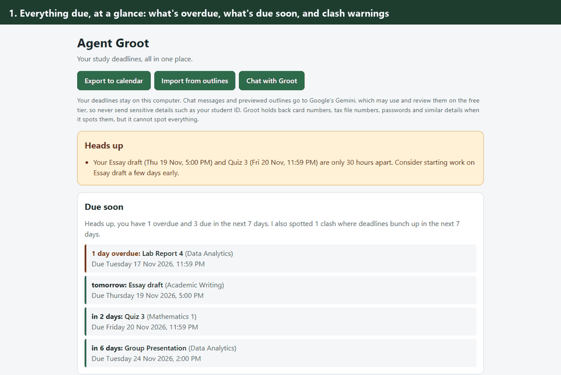

# Agent Groot: a study deadline assistant

[](https://github.com/Richardyan701/deadline_tracker_agent/actions/workflows/tests.yml)

**Agent Groot is a free, open-source study assistant that keeps track of your university deadlines.** Drop in your subject outlines and it finds every assessment and its real date, then reminds you before anything is due. You can also just tell it: *"Quiz 2 due next friday 5pm"*.

It has the calendars of **UTS, UNSW, the University of Sydney and Macquarie University** built in. At any other university, you type when week 1 starts and it does the rest.

Designed and built by Richard Yan, a first-year Artificial Intelligence student at UTS in Sydney, with Google's Agent Development Kit (ADK) and Gemini, and with Claude as a coding partner (see [How this was built](#how-this-was-built)). It runs on your own computer.



*Importing the made-up sample outline that comes with Groot. Every deadline shown is made up.*

> **Privacy:** your deadlines stay on your computer. Chat messages and outlines you preview go to Google's Gemini, and on the free tier Google may use and review them. So don't type anything private, like your student ID, passwords, or health and money details.
>
> Groot has a safety net: before anything is sent or saved, it checks on your own computer for card numbers, tax file numbers, Medicare numbers, passwords, API keys, bank details and student IDs, and holds them back. It only recognises patterns, so it won't catch everything.

## What it does

- **Reads your subject outlines** (PDF, Word, slides, spreadsheets, images and more) and turns "due in week 7" into a real date. Each university counts its weeks differently, so you pick yours and Groot uses its official 2027 calendar.
- **Understands plain English dates** like "next friday 5pm", "in 3 days" or "20/11". The date maths is done by tested Python code, not guessed by the AI.
- **Reminds you** of anything overdue or due soon, and **warns you about clashes** when deadlines bunch up.
- **Works out the mark you need** on the rest of a subject to get a Pass, Credit, Distinction or High Distinction.
- **Feeds the calendar you already use.** One click exports your deadlines to Google Calendar, Outlook or your phone. It also imports your Canvas calendar (UTS and USyd) and your UTS timetable.
- **Has a home page that uses no AI**, plus a chat with Groot.
- **Holds back sensitive details.** A chat message with a card number or password in it is never sent to the AI. The same details are removed from outlines and never saved.

## Quick start

You need **Python 3.11 or newer** and a free **Gemini API key** from [Google AI Studio](https://ai.google.dev/gemini-api/docs/api-key).

1. **Set up once.**
   - Windows: double-click `setup_windows.bat`.
   - Linux or macOS: run `./setup.sh`.

   It installs everything, asks for your key, and asks which Gemini model to use. Press Enter for the recommended one, which has a much bigger free daily limit.
2. **Start Groot.**
   - Windows: double-click `start_groot.bat`.
   - Linux or macOS: run `./start_groot.sh`.

   Your browser opens the home page at <http://127.0.0.1:8000/groot>. Press Ctrl+C in the start window to stop.
3. **Use it.** Add deadlines on the home page, import your outlines, or open the chat and say hello. No outline to hand? The import page has a made-up sample one you can try.

If something goes wrong, run the setup checker. It tells you what to fix:

```
.\.venv\Scripts\python.exe -m deadline_agent.check_setup     (Windows)
.venv/bin/python -m deadline_agent.check_setup               (Linux and macOS)
```

## A quick example

> **You:** Add Quiz 2 due next friday 5pm for Machine Learning
>
> **Groot:** Added **Quiz 2** for **Machine Learning**, due Friday, 13 November 2026 at 5:00 PM!
>
> **You:** what's my next deadline?
>
> **Groot:** Your next deadline is **Quiz 2** for **Machine Learning**, due on Friday, 13 November 2026 at 5:00 PM.

This is real output from the real Gemini model. Groot passes "next friday 5pm" to its tool exactly as typed, and Python works out the date.

## How well does it work?

Measured with the real Gemini model, not just claimed:

| Test | Result |
| --- | --- |
| **Reading 5 real UTS outlines** | 93% of assessments found, none invented, **0 silently wrong dates** |
| **Reading 1 real outline each from UNSW, USyd and Macquarie** | Every assessment, weight and week read correctly |
| **69 realistic student messages** (dates, listing, editing, marking done, off-topic, prompt-injection attempts) | **68 of 69 passed** with the lighter Flash-Lite. Gemini 3.5 Flash passed all 63 of the earlier cases |
| **Automated tests** | About 2,100, run on Python 3.11, 3.13 and 3.14 on every change |

Gemini does not answer the same way every time, and these are small samples, so read them as "no failures in these runs", not "it never fails". The weak spot was one outline (31265), where Groot missed two items and got two weights wrong. Full tables are in the [reference](docs/reference.md#results-so-far).

## Why does Groot feel similar to Notion?

Because both give you one place to keep your study life in order: a list of tasks with due dates, grouped by subject, with reminders and an AI helper you can talk to. If you have used a Notion assignment tracker, Groot's home page will feel familiar.

**What is similar**

- A list of deadlines with a due date, a subject and a done tick.
- Reminders for what is overdue or due soon.
- An AI assistant that adds and finds things when you ask in plain English.
- Your deadlines can go into a calendar.

**What is different**

| | Groot | Notion |
| --- | --- | --- |
| What it is for | One job: university deadlines | A general workspace for notes, documents and databases |
| Where your data lives | A file on your own computer | Notion's cloud, in your account |
| Setting up a tracker | Nothing to build | You build one or pick a template |
| Phones and sharing | No. One computer, one user | Yes. Syncs across devices and works for teams |
| Notes, documents and wikis | No | Yes |
| Cost | Free and open source, with Gemini's free tier | Free plan, with paid plans for more AI use |

**What Groot does that Notion does not do out of the box**

- **Knows your university's calendar.** "Due in week 7" becomes the real date at UTS, UNSW, USyd or Macquarie, with each one's mid-session break and the public holidays handled. In Notion, you or the AI have to work that date out.
- **Works dates out in tested code, not by AI.** The same phrase always gives the same date, and unclear dates are refused instead of guessed.
- **Shows how sure it is.** Every imported row is marked exact, assumed or needing your date, and nothing is saved until you tick it.
- **Warns about clashes and works out the mark you need** with no formulas to write.
- **Publishes its accuracy.** The results above come from real outlines and real chats, including the mistakes.
- **Runs without an account**, and the home page works with no AI at all.

**Where Notion is better:** it works on your phone, syncs everywhere, lets you edit anything, handles notes and group work, and has a polished design. Groot is not trying to replace it. This comparison is based on Notion's public help pages in November 2026, and Notion changes quickly.

## Things to know

- **The free limit on the default model is small:** about 20 requests a day, which is roughly 8 to 10 chat messages. Groot tells you politely when you hit it, and the home page never uses the AI.
- **When Gemini is busy** ("high demand"), Groot quietly hands your message to another free Gemini model with the same key. You only see an error if they are all busy. See [When Gemini is busy](docs/reference.md#when-gemini-is-busy).
- **You can get a much bigger limit for free.** Add `GROOT_MODEL=gemini-3.5-flash-lite` to `deadline_agent/.env` and restart. Flash-Lite ran more than 120 requests in one evening without hitting a limit. See [Choosing another Gemini model](docs/reference.md#choosing-another-gemini-model).
- **You can use another company's AI instead:** Groq, OpenAI (ChatGPT), Anthropic (Claude), xAI (Grok), DeepSeek, OpenRouter, or a model on your own computer with Ollama. It takes two lines in `.env`, and Groot's pages then say where your words go. Only Gemini models have been measured, and other models read outlines as text only. See [Using a model from another company](docs/reference.md#using-a-model-from-another-company).
- **Check the review table before saving imported deadlines.** Gemini can misread an outline.
- **Four Sydney universities are built in, up to the end of 2027.** Each year's dates are added by hand from the official calendars, and Groot tells you when a calendar has run out. For any other university or term, you type the session's dates yourself.
- **Groot runs on Sydney time** and only knows NSW public holidays, so outside the eastern states "due soon" can be a few hours out.
- **UTS is the best tested.** The other three universities have one real outline each behind them so far.
- **One user, one local file.** There are no accounts, and nothing syncs between devices.
- **Run it on your own computer only.** The chat page has no login.
- **The grade calculator can't check minimum rules** (like a minimum exam mark). Read your subject outline.

## Learn more

The [full reference](docs/reference.md) covers:

- [Date phrases it understands](docs/reference.md#date-phrases-it-understands)
- [Reminders](docs/reference.md#reminders-at-the-start-of-a-chat), [clash warnings](docs/reference.md#clash-warnings) and the [grade calculator](docs/reference.md#grade-calculator)
- [Importing outlines](docs/reference.md#importing-deadlines-from-your-outlines) and [supported file types](docs/reference.md#supported-file-types)
- [Export to your calendar](docs/reference.md#export-to-your-calendar)
- [Setup details](docs/reference.md#setup) and [troubleshooting](docs/reference.md#troubleshooting)
- [How it is built](docs/reference.md#how-it-is-built), [security and privacy](docs/reference.md#security-and-privacy) and [known limitations](docs/reference.md#limitations-and-known-gaps)
- [The tests](docs/reference.md#tests-and-ci) and [how the accuracy was measured](docs/reference.md#measuring-how-well-it-works)

## How this was built

I'm Richard Yan, and I designed and directed Groot. I decided what it should do and what it must never do: hold no one's data, cost nothing to run, keep sensitive details away from the AI, and check facts against real sources before building on them. I also reviewed and tested each change before it was merged.

Much of the code was written by Claude, Anthropic's AI, in Claude Code, working to my instructions. Every change had to pass three kinds of checks before it went in:

- **About 2,100 automated tests**, run by GitHub Actions on every change.
- **Live tests with the real AI model**, for example real outlines from UNSW, USyd and Macquarie.
- **The measured evaluations** above, which score the agent on real outlines and realistic chat messages, mistakes included.

The git history shows this openly: the commits are authored by me, with Claude credited as co-author where it wrote the code.

## Licence

MIT. See [LICENSE](LICENSE).
